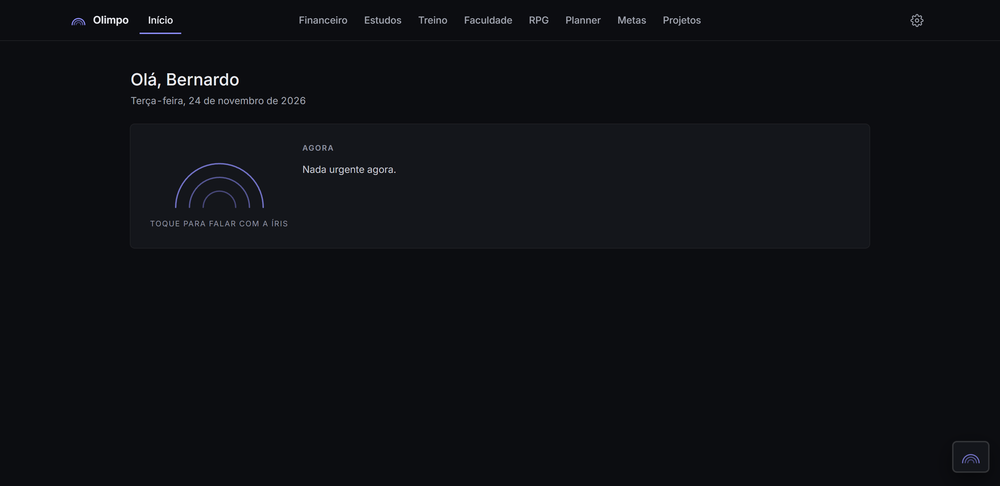
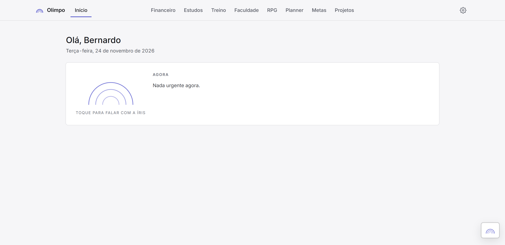
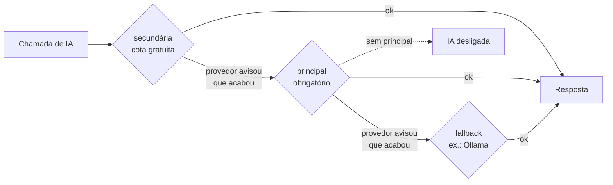
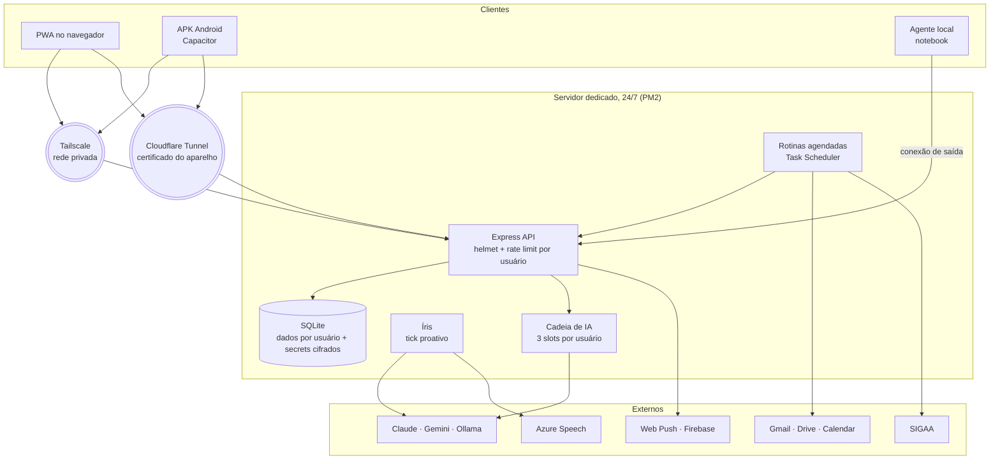

# Olimpo

App pessoal que junta finanças, estudos, faculdade, planejamento, treino e metas num lugar só. Roda como PWA no navegador e como app Android, conversando com um servidor que fica ligado o tempo todo num PC em casa. A assistente do app se chama Íris.

<p align="center">
  
  
  
  
  
  
</p>

<p align="center">
  
</p>
<p align="center">
  
</p>

## Sobre

Comecei o projeto para parar de usar um app diferente para cada coisa. Hoje ele é o que uso no dia a dia, e alguns amigos também usam: são cerca de 75 mil linhas de TypeScript e JavaScript, 8 módulos e mais de 70 rotas de API. O servidor roda num PC dedicado com PM2. O celular acessa pelo Tailscale ou por um endereço público que só abre com o certificado instalado no aparelho.

Também serve para eu praticar integração com IA, automação e arquitetura de um sistema maior do que os exercícios da faculdade.

## Módulos

| Módulo | O que tem |
| --- | --- |
| Estudos | Simulados com cronômetro, caderno de erros, questões e flashcards com repetição espaçada (SM-2), resumos com tutor e geração de conteúdo a partir dos sub-tópicos em que mais erro |
| Faculdade | Disciplinas, avaliações, notas e tarefas. Lê PDFs dos materiais e sincroniza com o SIGAA (via Puppeteer), com as credenciais de cada usuário cifradas no servidor |
| Financeiro | Quanto sobrou e quanto ainda dá para gastar por dia (descontando as contas fixas que ainda vão cair), importação de extratos e faturas, revisão rápida, regras de categoria, orçamentos, vários cartões, reembolsos, investimentos e relatórios |
| Planejador | Rotina semanal, plano de sessões de estudo e o dia de hoje para marcar |
| Projetos | Projetos, frentes, tarefas, bugs e decisões, com visualizador de arquivos e histórico de atividade |
| Treino | Registro de treinos e requisitos de teste físico |
| Metas | Objetivos com acompanhamento de progresso |
| RPG | Personagem, atributos e campanhas ligados à produtividade |

Cada módulo segue o mesmo esqueleto: um resumo que responde a pergunta principal num número e numa frase, ao lado de um cartão "Precisa de você" com os avisos daquele módulo. As abas de uso diário vêm depois, e "Configurar" fica por último. Os avisos de todos os módulos também aparecem na tela inicial.

## Íris

A Íris é uma assistente que usa a API da Anthropic e tem cerca de 50 ferramentas para ler e alterar dados do app. Ela consulta a agenda da faculdade, lança uma transação, cria um flashcard, reagenda uma sessão de estudo, busca e-mails e arquivos no Drive e controla mídia no computador. Também fala (voz neural em português pelo Azure) e pode chamar a atenção por conta própria. O símbolo dela são três arcos (o arco-íris do mito), animados conforme ela ouve, pensa ou fala, e o mesmo desenho é o logo do app.

Algumas decisões que tomei nela:

- A iniciativa própria passa antes por uma checagem simples, sem IA. O modelo só é chamado se essa checagem liberar, para não gastar token à toa.
- Toda chamada passa por um único ponto que calcula o custo (incluindo cache) e soma o total do mês.
- A persona e as regras ficam num bloco fixo com cache. O contexto que muda (hora, números do dia, memória) vai num bloco separado.
- Tudo que a Íris altera vai para um log, e os itens da caixa de entrada têm botão de desfazer. Ações em lote, como recategorizar várias transações, começam em dry-run e só executam depois que eu confirmo.
- O agente que roda no notebook abre a conexão para o servidor, em vez de ficar escutando numa porta. Assim funciona em qualquer rede, até no 4G, sem mexer no roteador. Ele só executa comandos de uma lista fechada.

## Configuração da IA

Não existe provedor fixo. Cada usuário define três slots em Configurações → IA, com a própria chave, e cada chamada tenta nesta ordem:



A cadeia começa pela cota gratuita para que as gerações automáticas (SIGAA, briefing, plano semanal) não gastem o crédito pago que vou querer usar depois. Ela só passa para o próximo slot quando o provedor diz que a cota acabou. Tentar prever isso por conta própria daria errado, porque os limites mudam sem aviso.

Os erros são classificados pela mensagem antes do código HTTP, porque "saldo esgotado" e "chave inválida" chegam com o mesmo status. Para adicionar um provedor novo basta criar um arquivo em `server/ai/adapters/`. Não existe chave do servidor como reserva: sem slot principal a IA fica desligada para aquele usuário, para o custo de um não cair na conta de outro.

## Vários usuários

Começou como app de uma pessoa só e hoje atende alguns amigos no mesmo servidor:

- Toda linha de dado pertence a um usuário. A camada de dados lê o usuário de um contexto assíncrono (`AsyncLocalStorage`) e se recusa a rodar sem ele, para que um job agendado não grave na conta errada por esquecimento.
- Quem está no tailnet é identificado pelo login do Tailscale. Pelo endereço público, só pelo certificado do aparelho que a Cloudflare verificou. O painel de usuários emite esse certificado de ponta a ponta, e a chave e a senha existem só na resposta daquela vez.
- Cada um escolhe os módulos que quer ver. O administrador pode "ver como" outra pessoa para reproduzir um problema, e pode pôr um módulo em manutenção para todo mundo, menos para ele.
- Integrações como o SIGAA são por usuário, cifradas no banco e nunca devolvidas ao navegador.

## Arquitetura



As rotinas agendadas registram cada execução, e uma tela de saúde do sistema mostra o que falhou ou ficou quieto por tempo demais. Um job diário que não roda há dois dias vira aviso na tela inicial.

## Problemas que apareceram

Alguns bugs e erros de projeto que acabaram virando regra no código:

- A chave do Gemini já ficou no `kv_store`, que é entregue inteiro ao navegador. Hoje as chaves ficam numa tabela `secrets`, cifradas com AES-256-GCM, e a tela só descobre se existe uma chave, sem nunca receber o valor.
- Por um tempo o Ollama era o último fallback incondicional. Toda falha do Gemini tentava `localhost` e terminava em `fetch failed`, o que escondeu por semanas que o saldo tinha acabado. Agora ele só entra se for configurado.
- Eu detectava "estou rodando no APK" olhando `window.Capacitor`, que existe em qualquer ambiente. Resultado: o `npm run dev` passou a escrever no banco de produção sem aviso. Troquei por `isNativePlatform()`.
- "Que dia é hoje" era calculado com `toISOString()`, que dá o dia em UTC: depois das 21h no Brasil já era amanhã, e cerca de 30 lugares (sequência de dias, check-in, treino do dia) erravam toda noite. Hoje uma única função dá o dia local, usada pelo app, pelo servidor e pelos scripts.
- Cada tela tinha sua própria ideia de "mês" e de "quanto gastei": a dashboard e os orçamentos mostravam valores diferentes para o mesmo mês, e a assistente contava uma compra estornada como gasto. Juntei as regras de mês financeiro e de totais em dois arquivos compartilhados entre o app e o servidor.
- Um script que lia o banco direto, sem tempo de espera para o lock, derrubou a inicialização do servidor. Agora todo script abre o banco por um helper com `busy_timeout`.
- O popup do `<select>` nativo é desenhado pelo sistema operacional e ignora o design system. Troquei os 27 usos por um componente próprio.

## Visual

Visual "Editorial": fundo neutro, um único destaque índigo, cartões contornados por uma linha de 1px com cantos de 6px, abas sublinhadas e dois temas, claro e escuro, que seguem o aparelho. As cores de texto são sólidas e passam no contraste AA nos dois temas. Todas as cores vêm de variáveis `--hub-*`, a fonte Inter vem empacotada para funcionar offline, e componentes como `Card`, `ModuleHeader`, `Select`, `DateField` e `Toast` são compartilhados entre os módulos.

## Stack

| Camada | Tecnologias |
| --- | --- |
| Frontend | React 19, TypeScript, Vite 7, Tailwind CSS, React Router 7, KaTeX |
| Backend | Node 22, Express, SQLite (`node:sqlite`), Zod, helmet, express-rate-limit |
| IA | Anthropic SDK (Claude), Gemini, Ollama, Azure Speech |
| Integrações | Gmail, Drive e Calendar, SIGAA (Puppeteer), Web Push, Firebase Cloud Messaging |
| Entrega | PWA com service worker, APK Android (Capacitor) com atualização pelo próprio app, PM2, Windows Task Scheduler, Tailscale, Cloudflare Tunnel |

## Estrutura

```
src/
  app/          entrada, layout e rotas raiz
  core/         ai, storage, alerts, session, navigation, theme, config, push, backup
  modules/      finance, study, college, planner, fitness, goals, rpg, projects
  shared/       componentes, hooks e regras compartilhadas com o servidor
server/
  ai/           cadeia de slots e adaptadores de provedor
  jarvis/       a Íris: agente, ferramentas, orçamento, auditoria e memória
  connections/  integrações por usuário
scripts/        sincronizações, rotinas agendadas e verificações (*-check.js)
agent/          agente local da Íris
android/        projeto Capacitor
```

## Como rodar

Precisa de Node 22 ou mais novo.

```bash
npm install
cp .env.example .env     # preencha CREDENTIALS_ENCRYPTION_KEY (explicação no arquivo)

npm run dev:full         # Vite + API
npm run check            # tsc -b
npm run build            # tsc + vite build
npm test                 # scripts/*-check.js
```

A IA só liga depois que um slot principal é configurado em Configurações → IA. As chaves ficam cifradas no servidor. Para usar fora do computador, defina `HUB_BACKEND` e `VITE_HUB_BACKEND` no `.env` com o endereço do servidor no seu tailnet, e `HUB_PUBLIC_URL` se quiser o APK no endereço público.

## Segurança

- Credenciais, tokens e dados em trânsito ficam fora do repositório. Em `.env.example` aparecem só os nomes das variáveis.
- As chaves de IA e as credenciais de cada usuário são cifradas no banco e nunca voltam para o navegador.
- O endereço público só responde a aparelhos com certificado, e as rotas de administração e de controle de máquina não existem nele, nem para o administrador.
- O agente local só executa comandos de uma lista fechada.
- A IA é consultiva. Ações destrutivas ou em lote passam por dry-run e confirmação.

## Autor

Bernardo dos Santos Ferreira, estudante de Ciência da Computação no IFSC (Lages/SC).
[GitHub](https://github.com/bernardo-dos-santos) · [LinkedIn](https://www.linkedin.com/in/bernardo-dos-santos-ferreira-221603356)

Projeto pessoal publicado como portfólio, sem licença de reutilização definida.
